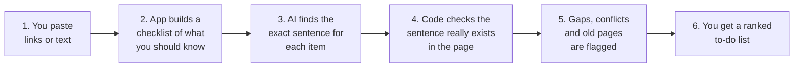

<div align="center">

# Denoy

### Find out what the websites you are reading do *not* tell you.

Paste a few links about any important decision. Get back what is **missing**, where sources **disagree**, what is **out of date**, and exactly **what to verify next**.


[**Try it in 2 minutes**](#4-try-it-in-2-minutes) · [**How it works**](#6-how-it-works) · [**FAQ**](#10-faq) · [**Project layout**](#12-project-layout)

</div>

---

## 1. The problem, in one story

Riya wants to apply for a scholarship. She opens four websites and thinks she understands everything. She does not.

| What Riya missed | Why she missed it |
| :--- | :--- |
| One site says the family income limit is **2.5 Lakh**, another says **8 Lakh** | Nobody put the two side by side |
| **No site** says whether she must re-apply every year | You cannot notice what is not written |
| The top Google result is a blog from **two years ago** | Old pages look just as confident as new ones |

Search engines only find links. AI summarizers squeeze pages into smooth paragraphs and often hide the disagreements or invent the missing parts.

**Denoy audits your sources like a careful fact-checker.** It reads them side by side, shows the gaps and conflicts, proves every claim with the original sentence, and gives you a ranked to-do list.

---

## 2. What it finds

| # | Knowledge Gap Type | Meaning | Example |
| :-: | :--- | :--- | :--- |
| 1 | **Gap** | An important question that none of your sources answers | "Renewal rules not found in the sources reviewed" |
| 2 | **Conflict** | Two sources give different facts | "Deadline is 30 June in one page, 31 March in another" |
| 3 | **Outdated** | Old pages, past academic years, expired deadlines | "This page talks about the 2022-23 cycle" |
| 4 | **Uncertain** | The AI claimed something but the exact sentence could not be found in the page | "Please check this one by hand" |

---

## 3. What you see

You type a question and paste links. You get a report like this:

```text
TOPIC: What should I verify before applying for this scholarship?
Sources reviewed: 3      Checklist items: 6      Covered: 5

[GAP] POTENTIAL GAP
   Renewal conditions were not found in the sources reviewed.

[CONFLICT] POSSIBLE CONFLICT   Required documents
   Source 1 (official page): "income certificate, Class 12 marksheet and Aadhaar card"
   Source 2 (blog post)    : "salary slip of parents, marksheet and photo ID"

[OUTDATED] MAY BE OUTDATED
   Source 2 mentions the 2022-23 cycle and a deadline in March 2023.

[ACTION] VERIFY NEXT
   [P1] Confirm the current deadline on the official notice
   [P1] Confirm the official document list
   [P2] Ask the scholarship office about renewal rules
```

*Illustrative output. Run the demo below to see the real thing.*

---

## 4. Try it in 2 minutes

No coding knowledge needed, only copy and paste. You do **not** need an API key for the first try.

**Step 1: Open a terminal inside the project folder.**  
A terminal is the text window where you type commands. On Windows search for *Command Prompt*, on Mac or Linux search for *Terminal*.

**Step 2: Install required packages** (one time):
```bash
pip install -r requirements.txt
```

**Step 3: Turn on offline demo mode.**  
Create a file named `.env` in the project folder (or copy `.env.example`) and put this line in it:
```env
MOCK_LLM=1
```

**Step 4: Start the application:**
```bash
python3 -m uvicorn app:app --reload --port 8000
```

**Step 5: Open your browser** and visit:  
**http://127.0.0.1:8000**

Offline mode uses ready-made realistic sample data, so it works completely without internet, which is ideal for live presentations.

<details>
<summary><b>Prefer the terminal only? Click here</b></summary>

<br>

Instant demo on sample scholarship pages:
```bash
python3 cli.py --demo
```

Type your own links in the terminal:
```bash
python3 cli.py --interactive
```

</details>

---

## 5. Use real AI (free)

Offline mode shows the experience. To analyze **your own** custom sources, connect a free AI service. Pick one, open `.env`, and fill it in:

<details>
<summary><b>Option A: Groq (fast, free, no credit card)</b></summary>

<br>

Get a key at https://console.groq.com/keys, then set:
```env
MOCK_LLM=0
GROQ_API_KEY=your_free_groq_api_key_here
GROQ_MODEL=llama-3.3-70b-versatile
```

</details>

<details>
<summary><b>Option B: Google Gemini (free tier)</b></summary>

<br>

Get a key from Google AI Studio, then set:
```env
MOCK_LLM=0
GEMINI_API_KEY=your_gemini_api_key_here
LLM_MODEL=gemini-1.5-flash
```

</details>

> **Security Note:** Keys live only in your local `.env` file. Never paste them in public chats and never upload `.env` to GitHub (it is protected by `.gitignore`).
>
> **Token Efficiency:** Every AI answer is cached in `.cache/llm_cache.json`, so asking the same question again is instant and consumes zero tokens.

---

## 6. How it works



In plain words:

1. **Collect:** You give a topic and sources (links, pasted text, or `.txt`, `.md`, `.pdf` files). The app downloads each page, removes menus and clutter, finds the publication date, and scores how official the source looks.
2. **Checklist:** The AI writes the list of things any careful person should know before deciding (eligibility, deadline, documents, renewal, and so on). These are *questions*, not facts.
3. **Extract:** For every checklist item, the AI copies the exact sentence from each source that answers it.
4. **Verify:** Plain Python code, **not AI**, searches the original page for that sentence. If it is not there, the claim is marked Uncertain. The AI cannot make up evidence.
5. **Compare:** The app finds gaps, conflicts and old information, then ranks what to verify next as P1, P2, P3.

---

## 7. Three trust labels (on every result)

| Label | Color Badge | What it tells you |
| :--- | :-: | :--- |
| **Sourced** | Green | Found in the source and matched character-for-character against the original text |
| **AI Suggestion** | Blue | Guidance from the AI, such as the checklist. Not from a source |
| **Uncertain** | Amber | The AI claimed it but the exact sentence was not confirmed. Check by hand |

---

## 8. Key features

<details open>
<summary><b>What you can do in the dashboard</b></summary>

<br>

| Feature | What it does for you |
| :--- | :--- |
| **Coverage matrix** | One table: checklist items down the side, sources across the top. Click a green cell to open the source with the sentence highlighted |
| **Quick filters** | Type a keyword or click `Show Only Gaps`, `Show Only Conflicts`, `High Priority Only` |
| **Source trust score** | 0 to 100% score. Official sites (`.gov.in`, `.nic.in`, `.edu`, `.ac.in`) rank high, blogs and aggregators are tagged third-party. Calculated by code, no AI used |
| **Action tracker** | Tick items off and watch the counter go from `0/4 Verified` to `4/4 Verified`. One click copies the to-do list |
| **History** | Every run is saved in your browser, so you can reopen a past report instantly |
| **Export** | Download a Markdown report or print a clean audit sheet |
| **Privacy modal** | Explains what stays on your device |

</details>

---

## 9. How it compares

| Capability | Search engine | AI summarizer | Denoy |
| :--- | :-: | :-: | :-: |
| Find relevant links | Yes | No | **Yes** |
| Spot contradictions between sources | No | Rarely | **Yes** |
| Show what is missing | No | No (often invents answers) | **Yes** |
| Prove each claim with the original sentence | No | No | **Yes (checked by code)** |
| Detect expired years and old cycles | No | Inconsistent | **Yes** |
| Rate how official a source is | Basic ranking | No | **Yes** |
| Tell you what to verify next | No | Generic tips | **Yes (ranked P1, P2, P3)** |

---

## 10. FAQ

<details>
<summary><b>Does it tell me what is true?</b></summary>

<br>

No, and it is built not to. It reports what **the sources you gave it** say, where they disagree, and what they leave out. Final rules must always be confirmed with the official authority.

</details>

<details>
<summary><b>If it says something is a gap, does that mean the information does not exist?</b></summary>

<br>

No. It means the information was not found in the sources reviewed. Add more or better sources and run again.

</details>

<details>
<summary><b>Can the AI make up quotes?</b></summary>

<br>

It can try, but it will not get through. Every quote is checked against the original page by code. A quote that is not on the page is flagged Uncertain, never shown as Sourced.

</details>

<details>
<summary><b>How many sources should I add?</b></summary>

<br>

At least two, ideally one official page plus a few others. Conflicts can only appear when there is something to compare.

</details>

<details>
<summary><b>A link did not work. What now?</b></summary>

<br>

Some sites need JavaScript or block downloads. Copy the page text and paste it in as a text source instead. The other sources still work normally.

</details>

<details>
<summary><b>Is my data sent anywhere?</b></summary>

<br>

In offline mode nothing leaves your computer. In live mode, the source text is sent to the AI service you chose so it can be analyzed. Your history is stored only in your own browser.

</details>

---

## 11. Automated tests

```bash
pytest -v tests/test_pipeline.py
```

The 10 automated tests confirm that real quotes pass, fabricated quotes are rejected, old academic years and past deadlines are caught, undated pages are flagged, conflicts rank above gaps, and the full pipeline runs end to end.

---

## 12. Project layout

<details>
<summary><b>Click to see the folder structure</b></summary>

<br>

```text
Denoy/
├── app.py                  Web server and API
├── cli.py                  Terminal version
├── dashboard.html          The interface you see in the browser
├── requirements.txt        Python packages
├── .env / .env.example     Your settings and keys
│
├── engine/                 The brain of the app
│   ├── pipeline.py         Runs all 10 stages in order
│   ├── checklist.py        Builds the "what should I know" list
│   ├── extractor.py        Pulls values and exact quotes from sources
│   ├── verifier.py         Code check: does this quote really exist?
│   ├── compare.py          Finds contradictions between sources
│   ├── fetcher.py          Downloads pages, finds dates, scores trust
│   ├── outdated.py         Checks dates and academic years
│   ├── priority.py         Ranks the P1, P2, P3 to-do list
│   ├── llm.py              Talks to Groq or Gemini
│   └── mock_llm.py         Offline demo data
│
├── public/                 Styles, images, sample result
├── docs/                   Build guide and specs
└── tests/                  Automated tests and sample pages
```

</details>

---

## 13. Honest facts guarantee

1. **No invented quotes.** Every quoted sentence is checked against the source by code.
2. **Findings, not assumptions.** Missing information is reported as "not found in the sources reviewed".
3. **Always confirm officially.** Every report reminds you to verify binding rules with the issuing authority before you decide.

---

<div align="center">

Built for the **Shinchan Online Hackathon 2026**

*Verify critical claims and spot information gaps with Denoy.*

</div>